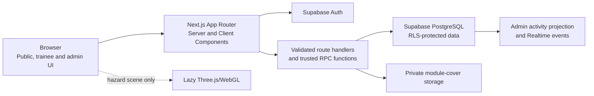

# IFI Safety360

<p align="center">
  
</p>

Safety360 is a responsive workplace learning platform developed for **Ignite Fusion Innovation (IFI)** in the logistics and automotive-warehousing context. It combines structured lessons, practical decisions, protected assessments, interactive mini-games, progress tracking and administration tools in one Supabase-backed application.

This repository is the University of Sunderland **CET257 Enterprise Project — Group 10** B6 application, created by **Team SWIMS** for **Ignite Fusion Innovation (IFI)**. Supporting B1 design documentation is included under [`docs/b1`](docs/b1).

| Project identity | Details |
| --- | --- |
| Company | Ignite Fusion Innovation (IFI) |
| Team | SWIMS |
| Academic group | Group 10 |

> Safety360 is a training prototype. Its content must be reviewed against the organisation's real procedures before it is used for employee instruction. It does not claim external accreditation or replace competent workplace supervision.

## Current status

The application is implemented and connected to the authorised Supabase project. The latest verified build on **1 October 2026** includes:

- separated trainee and administrator sign-in journeys;
- four built-in learning modules and four interactive mini-games;
- saved module, quiz and game progress;
- trainee assignment notifications;
- certificates for successfully completed modules;
- administrator module authoring, cover uploads, publication, assignment and safe draft deletion;
- a Supabase Realtime administration activity feed with automatic polling fallback; and
- responsive landing, About, Contact, authentication, trainee and administration interfaces.

Latest automated verification: **18 test files and 92 tests passed**, ESLint and TypeScript passed, the Next.js 16.3.8 production build generated all 40 build-time pages, and the production dependency audit reported zero vulnerabilities.

**Submission preview:** [IFI Safety360 live application](https://ifi-safety360-b6-group4.titungaayush8.chatgpt.site/)

The canonical Vercel deployment and final GitHub release are intentionally left for the repository owner.

## Product highlights

### Trainee portal

- Personal dashboard with the next assigned training action.
- Training library containing:
  1. **Hazard Perception & Unsafe Acts**;
  2. **Manual Handling**;
  3. **Working at Height**; and
  4. **Cyber Awareness**.
- Concise learning sections followed by practical activities and protected quizzes.
- Immediate decision feedback without exposing answer keys to the browser.
- Automatic checkpoints that allow a trainee to resume a lesson, activity, quiz or game.
- Assignment bell with unread state, due-date information and direct links to training.
- Progress dashboard, leaderboard, achievements and combined activity/quiz results.
- Completion certificates with a unique reference and print/save-to-PDF support.
- Responsive layouts designed for laptop, tablet and mobile use.

### Hazard Perception 360°

- Lazy-loaded Three.js/WebGL scene at `/training/hazard-perception/scene`.
- High-resolution warehouse panorama with seven operational hazards.
- Risk, possible-consequence and safer-action explanations.
- Duplicate-credit prevention and server-derived scoring.
- Pointer, touch and keyboard viewing controls.
- Keyboard-operable Hazard List View and a WebGL failure fallback.

The 360° activity remains independent from the newer mini-game system.

### Mini-Game to Learn

Trainees can open four saved challenges from `/games`. The same game types can also be included in administrator-authored modules:

| Mini-game | Learning interaction |
| --- | --- |
| **Forklift Simulator** | Navigate a controlled route, use brake and fork controls, yield at a crossing, move a load and park safely. |
| **PPE Dress-Up** | Select the task-specific PPE for three stated workplace scenarios using drag-and-drop or touch controls. |
| **Sorting Zone** | Categorise stock, hazardous materials and waste into the correct destination or incident response. |
| **Load Stacking Challenge** | Arrange loads within rack and bay limits, keep heavier loads low and isolate the damaged pallet. |

Game progress is saved with revision checks so an older tab cannot overwrite newer work. Scores are recalculated by PostgreSQL rather than accepted from the client. Standalone games do not issue module certificates; an authored game module advances into its own knowledge check and certificate flow.

More detail is available in the [mini-game setup and behaviour guide](docs/setup/MINI_GAME_MODULES.md).

### Administrator portal

- Management dashboard with trainee, assignment, score and overdue-training summaries.
- People management with active/inactive status and protected role handling.
- Module catalogue with clear draft and published states.
- Guided module authoring for:
  - title, summary, overview, category, duration, difficulty and pass mark;
  - learning objectives and lesson sections;
  - scenario decisions or one of the four mini-game templates;
  - knowledge-check questions and protected answer keys; and
  - a built-in cover or a JPG, PNG or WebP image uploaded from the device.
- Publication checklist and server-side validation before a module can be published.
- Permanent deletion only for eligible private drafts with no retained learner history.
- Training assignment, due-date updates and cancellation without erasing audit history.
- Results and reporting views with honest empty states.
- Real-time activity feed for trainee progress, quiz results, game activity, assignments, module events and account changes.

When Supabase Realtime is unavailable, the activity feed continues to refresh every 10 seconds and clearly reports that fallback state.

## Authentication and roles

The user-facing application has two roles:

| Role | Access |
| --- | --- |
| `trainee` | Dashboard, assigned/published learning, games, progress, results, achievements, certificates and profile. |
| `admin` | Management dashboard, people, modules, assignments, results, reports and live activity. |

Registration always creates a trainee profile. Administrator access must be granted through the trusted database workflow described in the [Supabase setup guide](docs/setup/SUPABASE_SETUP.md). A trainee cannot sign in through the administrator selector, and an administrator cannot enter through the trainee selector.

Legacy database values using `manager` are normalised to administrator behaviour by the application for compatibility; the current interface does not expose a manager option.

## Technology

| Area | Technology |
| --- | --- |
| Application | Next.js 16 App Router and React 19 |
| Language | Strict TypeScript |
| UI | Tailwind CSS 4 tokens, bespoke component CSS, Geist fonts and Lucide icons |
| Authentication/data | Supabase Auth, PostgreSQL, Row Level Security and trusted RPC functions |
| Realtime | Supabase Realtime with a 10-second polling fallback |
| File storage | Private Supabase Storage bucket for administrator-uploaded module covers |
| Immersive training | Three.js/WebGL with an accessible list alternative |
| Testing | Vitest plus SQL regression fixtures for disposable databases |
| Deployment | Next.js application prepared for Vercel |

Supabase PostgreSQL is the only Safety360 application database.

## Architecture



Correct quiz keys, scenario answers and game scoring rules stay in the protected database layer. The browser submits recognised choices and actions; the server validates identity, role, module state and scoring before progress or results are recorded.

## Main routes

| Area | Routes |
| --- | --- |
| Public/authentication | `/`, `/about`, `/contact`, `/login`, `/register`, `/forgot-password`, `/reset-password`, `/auth/callback` |
| Trainee | `/dashboard`, `/training`, `/training/[slug]`, `/training/[slug]/activity`, `/training/[slug]/quiz`, `/results/[attemptId]`, `/progress`, `/leaderboard`, `/achievements`, `/certificates`, `/profile`, `/help` |
| Mini-games | `/games`, `/games/[gameId]` |
| Immersive activity | `/training/hazard-perception/scene` |
| Administration | `/admin`, `/admin/users`, `/admin/training`, `/admin/training/new`, `/admin/training/[moduleId]`, `/admin/assignments`, `/admin/results`, `/admin/reports` |

## Repository structure

```text
app/                         App Router pages, layouts, route handlers and scoped styles
components/                  Authentication, layout, training, game, panorama and admin UI
lib/                         Auth, validation, queries, scoring, catalogue and resume logic
types/                       Shared TypeScript types
public/                      IFI assets, module covers and warehouse panoramas
supabase/migrations/         Database schema, security and feature migrations
supabase/seed.sql            Four built-in modules, protected questions and achievements
supabase/tests/database/     Permanent database security/training test source
tests/                       Vitest and disposable-database regression coverage
docs/b1/                     Design, architecture, traceability and user documentation
docs/setup/                  Supabase, mini-game and Vercel setup guides
docs/B6_RUN_INSTRUCTIONS.md  Local and hosted demonstration checklist
proxy.ts                     Next.js 16 Supabase session refresh boundary
.env.example                 Browser-safe environment template
```

## Local setup

### Prerequisites

- Node.js `22.13.0` or newer;
- npm;
- access to the configured Supabase project; and
- Docker plus the Supabase CLI only when using a local Supabase environment.

### Install and run

```powershell
npm install
Copy-Item -LiteralPath .env.example -Destination .env.local
npm run dev
```

Open [http://localhost:3000](http://localhost:3000).

Add the following browser-safe values to `.env.local`:

```dotenv
NEXT_PUBLIC_SUPABASE_URL=https://YOUR_PROJECT_REF.supabase.co
NEXT_PUBLIC_SUPABASE_PUBLISHABLE_KEY=sb_publishable_REPLACE_ME
NEXT_PUBLIC_SITE_URL=http://localhost:3000
```

`NEXT_PUBLIC_SUPABASE_ANON_KEY` is supported only as a legacy fallback. Never place a Supabase service-role key, database password or SMTP password in a `NEXT_PUBLIC_*` variable or commit `.env.local`.

See the [B6 run guide](docs/B6_RUN_INSTRUCTIONS.md) for the full demonstration sequence.

## Supabase database setup

Apply the migrations in filename order, then deliberately run `supabase/seed.sql`:

1. `202608150001_foundation.sql`
2. `202608150002_security_and_rls.sql`
3. `202608150003_training_rpcs.sql`
4. `202608300001_cyber_awareness.sql`
5. `202608310001_admin_module_authoring.sql`
6. `202609010001_module_covers_and_module_deletion.sql`
7. `202609020001_admin_module_workflow_polish.sql`
8. `202609030001_progress_resume_and_assignment_notifications.sql`
9. `202609070001_mini_game_activity_kind.sql`
10. `202609090001_admin_activity_feed.sql`
11. `202609090002_admin_activity_feed_fixes.sql`
12. `202609090003_interactive_learning_games.sql`
13. `supabase/seed.sql`

The linked project was updated through Supabase SQL Editor and verified on 11 September 2026. Because that manual application does not automatically populate the Supabase CLI migration ledger, reconcile migration history before using `supabase db push`. Do not blindly rerun non-idempotent migrations against a populated project.

The setup guide covers authentication redirects, administrator promotion, RLS verification, storage and Realtime configuration: [docs/setup/SUPABASE_SETUP.md](docs/setup/SUPABASE_SETUP.md).

## Useful commands

```powershell
npm run dev          # Next.js development server
npm run build        # Canonical Next.js production build
npm run start        # Run the Next.js production build
npm run typecheck    # Generate route types and run TypeScript
npm test             # Run all Vitest tests once
npm run test:watch   # Run Vitest in watch mode
npm run lint         # Run ESLint
npm run site:build   # Build the supplemental Sites/Vinext target
```

Latest verified results on 12 September 2026:

| Check | Result |
| --- | --- |
| `npm test` | 18 files, 92 tests passed |
| `npm run typecheck` | Passed |
| `npm run build` | Passed |
| `npm run site:build` | Passed; the adapter reports a large-chunk advisory and incomplete static route classification |

SQL regression fixtures in `tests/sql` must be run only against a disposable database. They create synthetic users and roll back their work. See [`tests/sql/README.md`](tests/sql/README.md).

## Deployment

### GitHub

The repository owner can commit and push the current branch when ready:

```powershell
git status
git add README.md
git commit -m "Update README for completed Safety360 build"
git push -u origin UI
```

Review `git status` before committing so unrelated local files are not added accidentally. If a different release branch is required, replace `UI` with that branch name.

### Vercel

The canonical deployment target is Vercel. Configure the same three public environment variables, add the production URL to the Supabase redirect allow-list and verify authentication, recovery email, role separation, storage, Realtime and a complete trainee journey after deployment.

See [docs/setup/VERCEL_DEPLOYMENT.md](docs/setup/VERCEL_DEPLOYMENT.md).

## Security model

- Protected routes require an active Supabase session and profile.
- Role checks are enforced at server boundaries and in PostgreSQL RLS/RPC logic.
- Registration cannot request administrator privileges.
- Correct quiz and scenario answers are not readable from the public schema.
- Quiz selections are locked before final submission, preventing a changed answer from replacing the first checked choice.
- Game outcomes and points are recomputed by trusted database functions.
- Assignment cancellation preserves history instead of deleting audit evidence.
- Uploaded module covers use a private, authenticated Supabase Storage bucket with type and size limits.
- Client-supplied progress percentages and scores are not treated as authoritative.

## Accessibility and responsive behaviour

- Semantic landmarks and heading structure.
- Skip link and visible keyboard focus.
- Labelled forms with accessible error and success feedback.
- Keyboard and touch alternatives for interactive activities.
- Reduced-motion support for transitions and progress animation.
- Responsive navigation, cards, tables, forms, quizzes and games.
- Hazard List View as an equivalent alternative to the visual 360° scene.
- Text/table equivalents for administration report summaries.

These are implementation provisions, not a formal accessibility certification. Final keyboard, screen-reader, zoom/reflow, reduced-motion and cross-browser acceptance evidence should still be recorded for the deployment environment.

## Known limitations

- The canonical Vercel deployment remains a repository-owner release step.
- Supabase's built-in email service is rate-limited and intended for development. Production confirmation and recovery email should use an approved SMTP provider.
- The Forklift Simulator is a simplified learning exercise, not a driving simulation or equipment authorisation.
- Load Stacking is a rule-based strategic puzzle, not a real rack-capacity or physics calculation.
- Browser-to-browser Realtime delivery should be smoke-tested again in the final production domain; the admin feed retains a polling fallback.
- The warehouse panorama is a demonstration visual rather than a client-site survey, and VR headset support has not been claimed.
- Formal stakeholder acceptance and organisation-specific health-and-safety review remain external project activities.

## Documentation

| Document | Purpose |
| --- | --- |
| [Requirements traceability](docs/b1/requirements-traceability.md) | Functional requirements, implementation and evidence mapping |
| [User stories](docs/b1/user-stories.md) | Trainee, administration and accessibility stories |
| [Use cases](docs/b1/use-cases.md) | Preconditions, main flows, alternatives and outcomes |
| [System architecture](docs/b1/system-architecture.md) | Application layers, trust boundaries and deployment topology |
| [Database ERD](docs/b1/database-erd.md) | Tables, relationships, protected data and RLS |
| [System flows](docs/b1/system-flows.md) | Authentication, training, administration and reporting flows |
| [UI design](docs/b1/ui-design.md) | Visual system, motion, responsive and accessibility decisions |
| [Testing plan](docs/b1/testing-plan.md) | Test scope and evidence boundaries |
| [Trainee guide](docs/b1/trainee-user-guide.md) | End-user training workflow |
| [Administrator guide](docs/b1/admin-user-guide.md) | Module, people, assignment and reporting workflow |
| [Mini-game guide](docs/setup/MINI_GAME_MODULES.md) | Interactive games, authoring, saving and scoring |
| [Supabase setup](docs/setup/SUPABASE_SETUP.md) | Database, authentication, roles, RLS, storage and Realtime |
| [Vercel deployment](docs/setup/VERCEL_DEPLOYMENT.md) | GitHub/Vercel environment and production checks |
| [B6 run instructions](docs/B6_RUN_INSTRUCTIONS.md) | Local and hosted demonstration checklist |

## Licence and content ownership

No open-source licence has been declared in this repository. Unless the project owner adds one, the source and supplied project assets should be treated as reserved for the IFI Safety360 academic project.
