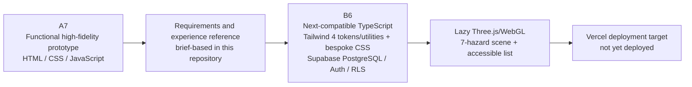

# A7 to B6 Evolution

## Evidence boundary

The user-supplied B6 folder was empty at the start of this work. It contained no A7 HTML, CSS or JavaScript source, no `localStorage` data model, no prior screenshots and no reusable brand/image asset pack. Consequently, the A7 column below records the baseline **stated in the B6 brief**, not independently inspected source evidence. It must not be cited as proof of a particular A7 implementation detail beyond that brief.

B6 is a clean application implementation rather than an embedded static prototype.

## Functional and technical progression

| Area | Stated A7 baseline (not independently verified) | B6 direction / implementation | Benefit and evidence boundary |
| --- | --- | --- | --- |
| Application structure | Static HTML/CSS/vanilla JavaScript prototype | Next.js App Router-compatible routes, strict TypeScript and React; hybrid Tailwind 4 `@theme` tokens/generated utilities plus bespoke industrial component CSS in `app/globals.css` | Enables reusable route/data boundaries and a maintainable product system. Local B6 source is evidence; no A7 source diff exists. |
| Persistence | Browser `localStorage` demonstration state | Supabase PostgreSQL tables, assignments, progress, attempts, achievements and activity records under RLS | Multi-session/user-ready persistence after remote setup. Not remotely verified yet. |
| Access | Demo access / prototype authentication | Supabase email/password registration, sign-in, recovery/reset, session persistence and protected routes | Removes frontend login bypass. Requires real Supabase credentials for proof. |
| Roles | Prototype trainee/admin presentation | Trusted `trainee`, department-scoped `manager` and `admin` profile roles; route checks plus database RLS | Browser cannot self-promote. Policy behaviour remains pending remote testing. |
| Hazard experience | Panoramic interaction concept | Lazy Three.js/WebGL scene with generated 2:1 panorama, seven unique hazards and equivalent Hazard List View | Genuine browser spatial interaction with progressive enhancement. Browser checks pending. |
| Hazard scoring | Demonstration interaction | Trusted activity RPC validates configured IDs and derives 100 points per unique hazard | Makes the 700-point maximum traceable and prevents duplicate database credit. Remote persistence pending. |
| Manual Handling | Prototype/planned learning | Complete learning content, five server-keyed first-choice decisions, immediate explanation and protected quiz | Moves from passive information to an assessable sequence without trusting caller score/progress. |
| Working at Height | Planned | Implemented core module with learning, five server-keyed first-choice decisions and protected quiz | Adds the third required core module with the same trusted activity boundary. Verification evidence pending. |
| Quizzes | Client-side prototype logic | One-question-at-a-time array/multi-select UI with 70% threshold; first checked selections are privately locked for two hours and final scoring requires exact locks/keys | Prevents ordinary trainee reads of the answer bank and prevents changing an answer after viewing authorised feedback. |
| Progress | Prototype/display state | Real denominator rule: non-cancelled assigned modules when any exist, otherwise published modules; strict learning + activity + quiz-pass completion | Avoids hard-coded percentages and defines completion unambiguously. |
| Leaderboard | Demo leaderboard | Database-derived snapshot using display name, points, completed modules and achievement without email exposure | Provides persistent, privacy-aware data once configured. |
| Admin data | Mock administrator data | Role-protected database values, filters, assignments, module status, results and reports; empty states for no data | Avoids invented operational numbers. Remote RLS/data integration pending. |
| Evidence | Prototype demonstration | Traceability, architecture, ERD, flows, test plan and pending screenshot register | Separates specifications/code paths from genuine test/stakeholder evidence. |

## Visual progression

| Stated A7 direction | B6 direction |
| --- | --- |
| Conventional dashboard styling | Original premium automotive-logistics visual direction with large industrial features and strong hierarchy. |
| Repeated generic cards | Split compositions, restrained cards, tables, progress strips and prominent training actions chosen by information type. |
| Prototype navigation | Dark stable desktop navigation and compact accessible mobile drawer. |
| Limited loading feedback | Genuine short bootstrap loader, route skeletons and dedicated WebGL scene loader. |
| Ad hoc animation | Central 180/320/650ms motion tokens, restrained transform/opacity effects and global reduced-motion behaviour. |
| Conceptual industrial scene | Original generated panorama plus code-driven hazard hotspots and equivalent list. |

The external logistics website mentioned in the brief was general inspiration only. Its layout, assets, branding, copy and source code were not copied.

## Architecture decision: Three.js instead of A-Frame

The brief permits A-Frame/WebGL “or another justified compatible implementation”. A-Frame was evaluated, but its current dependency tree introduced avoidable high-severity transitive advisories during implementation. B6 therefore uses a smaller, lazy-loaded Three.js/WebGL path. This still supports an equirectangular panorama, interactive hotspots and a future WebXR evolution without loading the 360 engine on ordinary pages.

This dependency decision reduces observed dependency exposure; it does not prove the application or Three.js is free of vulnerabilities. Dependency checks and updates remain part of the testing/maintenance plan.

## Product-flow evolution

## Outstanding evolution evidence

- Obtain the genuine A7 repository/archive if a source-level comparison is required.
- Capture B1-S01–B1-S18 only from a working configured B6 environment.
- Apply Supabase migrations and test identity, RLS, scoring, persistence and role scope with separate accounts.
- Connect GitHub/Vercel and record the real hosted URL only after deployment succeeds.
- Record genuine stakeholder feedback in `client-feedback-log.md`; do not convert internal implementation decisions into client comments.
