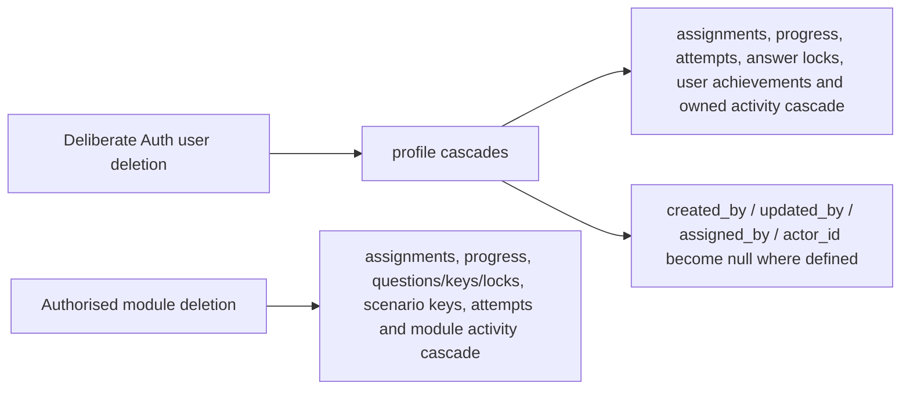

# B1 Database ERD

## Purpose and evidence status

This document matches the repository SQL in:

1. `supabase/migrations/202608150001_foundation.sql`;
2. `supabase/migrations/202608150002_security_and_rls.sql`;
3. `supabase/migrations/202608150003_training_rpcs.sql`; and
4. `supabase/seed.sql`.

Supabase Auth supplies `auth.users`; exposed application entities are under `public`, while quiz keys, first-answer locks and decision-scenario keys are isolated under `private`. The final hardened migrations and seed parsed and executed successfully in temporary embedded PostgreSQL-compatible environments, with local checks covering the principal RLS, trusted-function, answer-lock and server-derived activity-scoring paths. They were also applied to the authorised hosted project on 20 August 2026; owner verification confirmed the expected catalogue/private-key counts, 24 public policies and RLS enabled on `profiles`, followed by a genuine hosted-Auth local administrator sign-in. The pgTAP suite and complete hosted multi-role negative matrix remain unexecuted. SQL is authoritative after any future schema change, and this ERD must then be updated.

## Entity relationship diagram

```mermaid
erDiagram
    AUTH_USERS ||--|| PROFILES : "id owns profile"
    PROFILES ||--o{ TRAINING_MODULES : "creates or updates"
    PROFILES ||--o{ MODULE_ASSIGNMENTS : "receives"
    PROFILES ||--o{ MODULE_ASSIGNMENTS : "assigns"
    TRAINING_MODULES ||--o{ MODULE_ASSIGNMENTS : "is assigned"
    PROFILES ||--o{ MODULE_PROGRESS : "has"
    TRAINING_MODULES ||--o{ MODULE_PROGRESS : "tracks"
    TRAINING_MODULES ||--o{ QUIZ_QUESTIONS : "contains"
    QUIZ_QUESTIONS ||--|| PRIVATE_QUIZ_ANSWER_KEYS : "has protected key"
    TRAINING_MODULES ||--o{ PRIVATE_ACTIVITY_SCENARIO_KEYS : "has protected decision keys"
    PROFILES ||--o{ PRIVATE_QUIZ_ANSWER_LOCKS : "owns temporary locks"
    TRAINING_MODULES ||--o{ PRIVATE_QUIZ_ANSWER_LOCKS : "groups temporary locks"
    QUIZ_QUESTIONS ||--o{ PRIVATE_QUIZ_ANSWER_LOCKS : "is locked per user"
    PROFILES ||--o{ QUIZ_ATTEMPTS : "submits"
    TRAINING_MODULES ||--o{ QUIZ_ATTEMPTS : "is assessed by"
    PROFILES ||--o{ USER_ACHIEVEMENTS : "earns"
    ACHIEVEMENTS ||--o{ USER_ACHIEVEMENTS : "is awarded through"
    QUIZ_ATTEMPTS o|--o{ USER_ACHIEVEMENTS : "may trigger"
    PROFILES ||--o{ ACTIVITY_LOG : "owns or acts"
    TRAINING_MODULES o|--o{ ACTIVITY_LOG : "context"
    QUIZ_ATTEMPTS o|--o{ ACTIVITY_LOG : "context"

    AUTH_USERS {
      uuid id PK
      text email
    }
    PROFILES {
      uuid id PK_FK
      text full_name
      text employee_number UK
      text department
      app_role role
      profile_status status
      timestamptz created_at
      timestamptz updated_at
    }
    TRAINING_MODULES {
      uuid id PK
      text slug UK
      text title
      text description
      text overview
      text category
      smallint estimated_minutes
      difficulty_level difficulty
      module_status status
      boolean is_published
      smallint pass_mark
      smallint points_available
      integer sort_order
      jsonb learning_objectives
      jsonb content
      jsonb scene_config
      text hero_image_path
      timestamptz published_at
      uuid created_by FK
      uuid updated_by FK
      timestamptz created_at
      timestamptz updated_at
    }
    MODULE_ASSIGNMENTS {
      uuid id PK
      uuid user_id FK
      uuid module_id FK
      uuid assigned_by FK
      assignment_status status
      timestamptz assigned_at
      date due_date
      timestamptz completed_at
      text notes
      timestamptz created_at
      timestamptz updated_at
    }
    MODULE_PROGRESS {
      uuid id PK
      uuid user_id FK
      uuid module_id FK
      smallint progress_percent
      progress_status status
      boolean learning_complete
      boolean activity_complete
      integer points_earned
      timestamptz started_at
      timestamptz completed_at
      timestamptz last_activity_at
      timestamptz created_at
      timestamptz updated_at
    }
    QUIZ_QUESTIONS {
      uuid id PK
      uuid module_id FK
      quiz_question_type question_type
      text prompt
      jsonb options
      text explanation
      smallint points
      integer sort_order
      boolean is_active
      timestamptz created_at
      timestamptz updated_at
    }
    PRIVATE_QUIZ_ANSWER_KEYS {
      uuid question_id PK_FK
      jsonb correct_answer
      timestamptz created_at
      timestamptz updated_at
    }
    PRIVATE_ACTIVITY_SCENARIO_KEYS {
      uuid module_id PK_FK
      text scenario_id PK
      text_array allowed_choice_ids
      text correct_choice_id
      smallint points
      integer sort_order
      timestamptz created_at
      timestamptz updated_at
    }
    PRIVATE_QUIZ_ANSWER_LOCKS {
      uuid user_id PK_FK
      uuid module_id FK
      uuid question_id PK_FK
      jsonb selected_answer
      timestamptz expires_at
      timestamptz created_at
      timestamptz updated_at
    }
    QUIZ_ATTEMPTS {
      uuid id PK
      uuid user_id FK
      uuid module_id FK
      integer attempt_number
      integer score
      integer max_score
      numeric percentage
      boolean passed
      integer activity_score
      integer points_earned
      jsonb submitted_answers
      jsonb feedback
      timestamptz started_at
      timestamptz completed_at
      timestamptz created_at
    }
    ACHIEVEMENTS {
      uuid id PK
      text code UK
      text title
      text description
      text icon
      integer points
      jsonb criteria
      integer sort_order
      boolean is_active
      timestamptz created_at
      timestamptz updated_at
    }
    USER_ACHIEVEMENTS {
      uuid id PK
      uuid user_id FK
      uuid achievement_id FK
      uuid source_attempt_id FK
      timestamptz earned_at
    }
    ACTIVITY_LOG {
      uuid id PK
      uuid user_id FK
      uuid actor_id FK
      uuid module_id FK
      uuid attempt_id FK
      activity_event_type event_type
      text event_key
      jsonb metadata
      timestamptz created_at
    }
```

`AUTH_USERS` represents the managed `auth.users` relation and is shown only to make identity ownership explicit. The three `PRIVATE_*` entities represent relations under the non-client `private` schema; none is a public API relation or directly readable by trainee, manager or administrator clients.

## Enumerated domains

| Type | Allowed values |
| --- | --- |
| `app_role` | `trainee`, `manager`, `admin` |
| `profile_status` | `active`, `inactive`, `suspended` |
| `difficulty_level` | `introductory`, `intermediate`, `advanced` |
| `module_status` | `draft`, `published`, `archived` |
| `assignment_status` | `assigned`, `in_progress`, `completed`, `cancelled` |
| `progress_status` | `not_started`, `in_progress`, `completed` |
| `quiz_question_type` | `single_choice`, `multiple_choice`, `true_false` |
| `activity_event_type` | `module_started`, `learning_completed`, `activity_completed`, `quiz_completed`, `module_completed`, `achievement_earned` |

## Table catalogue and constraints

| Relation | Purpose | Primary integrity rules |
| --- | --- | --- |
| `public.profiles` | Trusted application identity, display/employee fields, department, role and status. | `id` is PK/FK to `auth.users(id)` with cascade delete; full name 1–120 characters; optional employee number is case-insensitively unique and at most 40 characters; optional department at most 100; new Auth hook ignores privileged sign-up metadata and defaults to active trainee. |
| `public.training_modules` | Catalogue, content, scene configuration, points/pass mark and publication metadata. | UUID PK; unique lower-case hyphenated slug; title/description/category length checks; minutes 5–240; pass mark 1–100; points 0–5000; objectives must be JSON array; content/scene config JSON objects; `published` requires `is_published=true` and `published_at`, while other statuses require false; creator/updater FKs set null on profile deletion. A guard rejects unpublish/archive while `assigned`/`in_progress` assignments exist. |
| `public.module_assignments` | One required-module assignment per user, with assigning actor and optional due date/notes. | Unique `(user_id,module_id)`; user/module cascade delete; assigner set null; due date cannot predate assignment date; notes at most 500; `completed` requires `completed_at`, other states require it null. Insert requires a published module for every actor; update cannot produce assigned/in-progress on an unpublished module. Repeated upsert updates due date/notes while preserving audit/system state. No authenticated delete; cancellation preserves history. |
| `public.module_progress` | Current learning/activity gate, percentage, total stored points and timestamps. | Unique `(user_id,module_id)`; both FKs cascade; percentage 0–100; points non-negative; completed means 100%, both learning/activity flags true and timestamp present; non-complete has no completed timestamp; started status requires `started_at`. |
| `public.quiz_questions` | Authored prompt/options/explanation/order and weight. | UUID PK; module cascade; unique `(module_id,sort_order)`; prompt 8–500 characters; explanation 8–1000; options JSON array of 2–10; points 1–100; positive sort order. Direct authenticated column-select omits `explanation`; clients load safe fields through `quiz_questions_for_module`. |
| `private.quiz_answer_keys` | Correct answer array, outside the exposed schema. | `question_id` is PK/FK with cascade; answer is a non-empty JSON array; validation trigger checks values against the question options/type. The schema/table has no ordinary client policy/grant. |
| `private.quiz_answer_locks` | Temporary first-checked answer per user/question for the active module attempt. | Composite PK `(user_id,question_id)`; user/module/question cascade FKs; selected answer is a non-empty JSON array; expiry defaults to two hours and must follow creation; indexes support user/module/expiry cleanup. RLS is enabled with no policies and all ordinary grants are revoked. |
| `private.activity_scenario_keys` | Server-held decision allowlist, correct choice, points and order for scenario activities. | Composite PK `(module_id,scenario_id)`; module cascades; lower-case scenario ID format; at least two lower-case choice IDs; correct choice must be allowed; points 0–1000; non-negative order. RLS is enabled with no policies and all ordinary grants are revoked. |
| `public.quiz_attempts` | Numbered immutable submissions, server score, activity snapshot, feedback and points. | Unique `(user_id,module_id,attempt_number)`; positive attempt; `0 <= score <= max_score`; percentage 0–100; activity/points non-negative; submitted answers object; feedback array; completion at/after start. Direct authenticated access is read-only and RLS-scoped. |
| `public.achievements` | Award definitions and machine-readable criteria. | Unique lower-case hyphenated code; title/description lengths; non-negative points; criteria JSON object. |
| `public.user_achievements` | Genuine user-to-achievement award, optionally linked to its quiz attempt. | Unique `(user_id,achievement_id)` prevents repeat award; user/achievement cascade; source attempt set null if removed. |
| `public.activity_log` | Minimal idempotent learning/quiz/completion events. | User cascades; actor/attempt set null; module cascades; metadata JSON object; optional event key 1–120 characters; partial unique `(user_id,module_id,event_key)` prevents duplicate milestone, hazard and decision events. |

The migration adds indexes for common catalogue, user/status/recent, overdue, attempt result, leaderboard and activity lookups. A shared trusted trigger maintains `updated_at` on mutable relations.

## Delete behaviour



Because module deletion can remove training history through cascades, ordinary lifecycle management should prefer draft/archive/publication state. Destructive behaviour must be verified and approved before real employee data is used.

## RLS and grant model

All application tables, including the three `private` relations, have RLS enabled. Grants are narrowed before row policies are evaluated; private relations have no client policy and no direct trainee, manager or administrator grant.

| Relation | Trainee | Manager | Administrator |
| --- | --- | --- | --- |
| `profiles` | Select own; update `full_name` only. Email stays with Auth; guard rejects role/status/department/employee/identity changes. | Select same-department active trainee targets through `can_manage_user`; direct protected-field changes remain restricted. | Select/update authorised profiles; `admin_update_profile` provides a narrower role/status contract and protects the final active administrator. Employee number/department provisioning uses an authorised administrative process. |
| `training_modules` | Select published rows. | Select published rows; management does not imply publication control. | Insert/update/delete under admin policies; `set_module_publication`/`manage_module` keep publication fields consistent. |
| `module_assignments` | Select own only. | Select/create/update/cancel same-department trainee assignments when module access and actor rules pass; no delete grant. | Authorised organisation-wide select/create/update/cancel scope; no authenticated delete grant. |
| `module_progress` | Select own; no arbitrary direct progress/points write. | Select manageable same-department trainee progress. | Select/direct admin mutation; normal trainee progression uses trusted functions. |
| `quiz_questions` | Select only safe granted columns for active questions in accessible published modules; no direct explanation column. | Same published-question read behaviour. | Row management policies permit authoring writes; private feedback/key paths remain separate. |
| `private.quiz_answer_keys` | No direct access. | No direct access. | No direct client policy; audited trusted scoring functions read the relation. |
| `private.quiz_answer_locks` | No direct access. | No direct access. | No direct client policy; trusted quiz functions create/validate/clear temporary locks. |
| `private.activity_scenario_keys` | No direct access. | No direct access. | No direct client policy; trusted activity/scoring functions read the relation. |
| `quiz_attempts` | Select own; no direct insert/update/delete grant. | Select manageable same-department attempts. | Select authorised attempts. |
| `achievements` | Select active definitions. | Select active definitions. | Read and admin-authorised writes. |
| `user_achievements` | Select own only. | Select manageable same-department awards. | Select authorised awards; writes occur through trusted award logic. |
| `activity_log` | Select own only. | Select manageable same-department activity. | Select authorised activity; writes occur through trusted functions. |

Anonymous users receive no application-table grants. Page/server checks improve navigation but do not replace RLS.

## Trusted functions

### Security helpers

- `current_app_role()` resolves an active authenticated profile role.
- `is_admin()` performs a trusted admin predicate.
- `can_manage_user(target_user_id)` grants admin scope or same-department manager access to active trainees.
- `can_access_training_module(target_module_id)` validates access to a published module or admin scope.

### Training and feedback

- `record_training_activity(module_id,event_type,progress_percent,event_key,metadata)` accepts only recognised milestones and ignores caller `progress_percent`; database rules derive all progress and points. For Hazard Perception, each `activity_completed` call requires one configured hazard ID. The idempotent log counts unique configured IDs, derives `count × 100` up to seven/700, and sets activity complete only after all seven. For Manual Handling and Working at Height, the call requires a module-matching scenario ID and `metadata.selectedChoiceId`; the private allowlist validates the choice, the first canonical event is immutable/idempotent, correct choices earn 100, wrong choices earn zero, and all five distinct attempted scenarios complete the activity regardless of score. Only sanitised choice/correctness/points metadata is stored.
- `quiz_questions_for_module(module_id)` returns only active safe question fields: ID, module, type, prompt, options, points and order. It omits authored explanation.
- `check_quiz_answer(question_id,selected_answer)` validates/normalises an active user’s selection, serialises the user/module operation, removes expired module locks and stores the first checked selection for two hours. An identical repeat is allowed; a different selection is rejected. Only after that lock succeeds does it return correctness and the authored explanation for that question.
- `submit_quiz(module_id,submitted_answers)` requires every active question exactly once and an unexpired first-answer lock that exactly matches each normalised submission. It scores against private keys and the module pass mark, creates the next numbered immutable attempt with `started_at` from the earliest matching unexpired lock (bounded at the current time), recomputes/snapshots activity score, reconciles progress/assignment/completion, clears locks after insertion, and returns authorised feedback/new achievements. A later failure rolls the transaction back, including lock deletion.

### Recognition, reporting and administration

- `leaderboard_snapshot()` returns privacy-limited `user_id`, `display_name`, `points`, `completed_modules`, `achievement` and dense `rank`; it omits email, employee number, department and raw profile fields.
- `quiz_attempt_result(attempt_id)` returns a publication-independent result to the owning trainee, same-department manager or administrator only. It returns IDs, attempt/score/activity/points/times and module slug/title, never submitted answers, feedback or keys; unauthorised/missing IDs return null.
- `reports_summary()` permits manager/admin only, returns managers’ same-department or administrators’ organisation-wide aggregates, uses the latest attempt per relevant user/module and returns JSON null for average quiz percentage when no latest attempt exists.
- `set_module_publication(module_id,published)` and `manage_module(module_id,published,status)` enforce admin role and consistent status/flag/timestamp fields. A shared advisory lock plus direct-update trigger rejects unpublish/archive with active `assigned`/`in_progress` assignments, closing assignment/withdrawal races. The matching assignment guard requires a published target on insert and prevents cancelled work being reactivated after withdrawal.
- `admin_update_profile(target_user_id,new_role,new_status)` enforces admin role, valid enums and protection against demoting/disabling the final active administrator.

Each public trusted function is revoked from `public`/`anon` and granted to `authenticated` only where intended. Security-definer functions set an empty `search_path` and schema-qualify objects. Embedded negative checks passed for selected profile, private-key/lock/scenario access, quiz oracle resistance, caller-score/progress rejection and department-scope paths; the full hosted negative matrix remains required.

## Completion, points and reporting rules

- Core seeded modules use a 70% pass mark.
- `record_training_activity` derives staged progress baselines: 5% after start, 45% after learning and up to 75% through activity; supplied progress values are ignored. The separate quiz/completion reconciliation controls the final 100% state.
- Completion requires `learning_complete`, `activity_complete` and a passed quiz attempt at the module pass mark.
- A completed progress row is exactly 100% with `completed_at`.
- Hazard activity is 100 points per unique configured hazard, maximum 700 for the seeded seven.
- Manual Handling and Working at Height each have five server-keyed decisions: 100 points for each correct first choice, zero for a wrong first choice and a 500-point activity maximum. Attempting all five completes the activity even when the score is below 500. Perfect combined activity/quiz totals are 700 for Manual Handling and 750 for Working at Height.
- Quiz points are proportional to quiz percentage and `training_modules.points_available`.
- `module_progress.points_earned` retains the best legitimate combined activity/quiz points rather than accumulating retries without limit.
- When non-cancelled assignments exist, their modules form the application overall-progress denominator; cancelled assignments are excluded. Otherwise published modules form the denominator.
- Reporting uses the latest quiz attempt per relevant user/module for current score indicators and excludes cancelled assignments from active/overdue figures.
- Overdue reporting means a non-cancelled assignment whose `due_date` is before the current date and whose status is `assigned` or `in_progress`.

## Seed catalogue

`supabase/seed.sql` is idempotent content seed data and contains no Auth user, email or password:

- exactly three published core modules, each at 70% pass mark;
- Hazard Perception scene config for lazy Three.js/WebGL, `/warehouse-panorama.png`, the accessible list and the exact seven required hazard IDs;
- five-decision metadata for Manual Handling and Working at Height plus exactly ten protected scenario-key rows (`mh-1`–`mh-5`, `wh-1`–`wh-5`), each worth 100 for the correct first choice;
- eight active questions plus private answer key per core module (24 total); and
- six achievement definitions: First Safety Check, Precision Result, Hazard Aware, Handling Ready, Height Aware and Core Safety Complete.

Applying seed data is a manual step. Official Supabase guidance limits `db push --include-seed` to fresh development/staging environments; production content provisioning needs its own reviewed, repeatable process.

## Privacy and limitations

- Submitted answer/feedback JSON and employee training state require an organisational retention, access and deletion policy before real use.
- Leaderboard name shortening reduces exposure but does not create consent; the client must decide participation/privacy policy.
- Department strings are the B6 scoping decision because no organisation/team relation was supplied. A normalised team relation would be preferable at larger scale.
- No quiz version relation exists; editing a question after historical attempts can complicate interpretation. Prefer controlled versioning before production content changes.
- Final backend SQL parsing and embedded PostgreSQL-compatible migration/seed, RLS, first-answer locking/oracle rejection, caller-score/progress rejection, trusted activity/quiz scoring, strict three-gate completion, assignment/module race-guard and scoped result/report checks passed on 15 August 2026. The permanent 48-assertion pgTAP suite was authored but not run with Supabase CLI/Docker, and no hosted migration/Auth/RLS or independent load/concurrency test has been executed. The testing plan records the exact evidence boundary.
