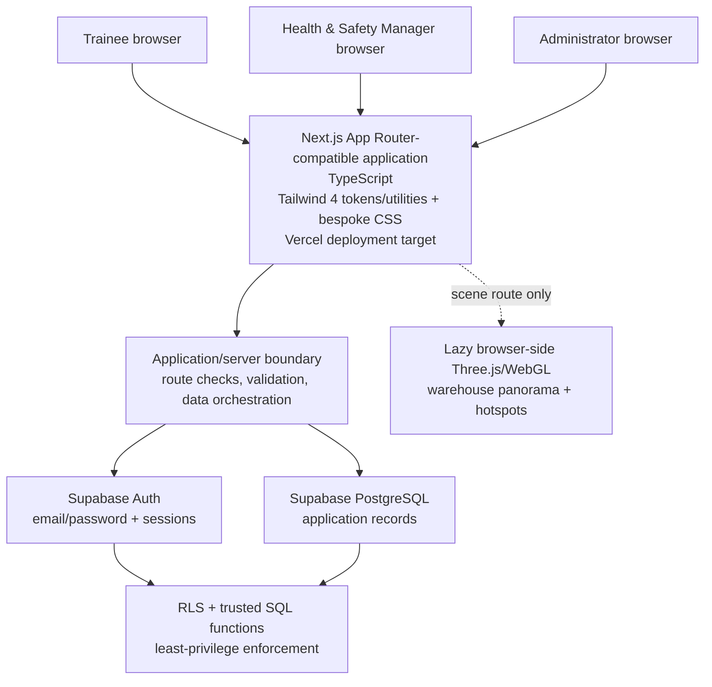
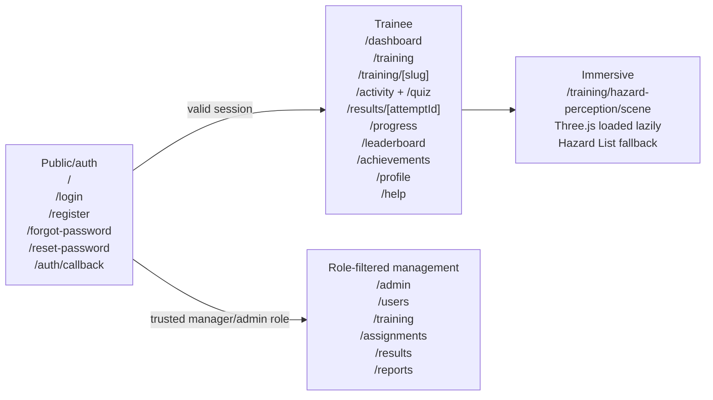
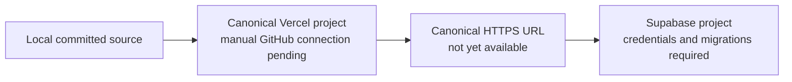

# B1 System Architecture

## Architectural objective

IFI Safety360 is designed as a Next.js App Router-compatible TypeScript application with Supabase providing Authentication, PostgreSQL persistence and Row Level Security. Styling is a hybrid: Tailwind CSS 4 supplies `@theme` design tokens and generated utilities used by the live interface, while `app/globals.css` also contains the bespoke production component/layout system. Three.js provides the justified browser-side WebGL path for immersive training. Vercel is the intended canonical host.

The user-supplied working folder was empty at the beginning of B6 work and contained no A7 source package, IFI asset pack, screenshots or reusable prototype code. The current structure is therefore a clean B6 application based on the stated A1/A7 requirements rather than a wrapped or inspected A7 implementation.

## Context diagram



## Logical layers

| Layer | Responsibilities | Important boundary |
| --- | --- | --- |
| Presentation | Public authentication, trainee workspace, administration views, responsive navigation, states and accessible alternatives. | UI visibility is not authorisation. Hidden controls alone never grant or deny access. |
| Interactive browser components | Forms, quizzes, decisions, progress presentation and the Three.js/WebGL scene. | Client input and role claims are untrusted. Private answer/lock/scenario relations are never queried by browser clients. |
| Application/server layer | Next 16 `proxy.ts` session refresh, profile/role-aware routing, parameter validation, database catalogue/progress orchestration and safe error mapping. | Uses the signed-in identity, fails closed when the trusted profile is missing/inactive and never exposes a service-role secret to the browser. |
| Supabase Auth | Credential handling, registration, verification/recovery flows and session tokens. | Application roles come from the trusted `profiles` row, not registration metadata supplied by the browser. |
| PostgreSQL/RLS | Modules, assignments, progress, attempts, achievements, activity and reporting data. | RLS and trusted functions remain the final database enforcement boundary. |
| Deployment | Vercel is the intended HTTPS Next.js host; Supabase is the managed backend. | Remote resources and redirects require manual configuration. No live environment currently exists. |

## Application areas and route ownership



- Public authentication is available without a session. Protected trainee pages require an authenticated user.
- `proxy.ts` refreshes the Supabase session for matched application requests; route/data helpers then require an active trusted profile and fail closed rather than inventing a trainee profile.
- A `manager` uses allowed `/admin` views but reads only relevant trainees in the same department. A missing department must not result in wider access.
- An `admin` can perform the wider actions explicitly authorised by database policy/function checks.
- New users default to `trainee`; the public registration interface cannot select or write a privileged role.

## Data and completion architecture

Training catalogue and learning content are separated from user state. `training_modules` and active `quiz_questions` describe the catalogue. Module pages enforce the database publication/access result and use database metadata/current progress rather than trusting a route slug or static card state. Correct quiz responses are isolated in `private.quiz_answer_keys`; temporary first-checked selections are isolated in `private.quiz_answer_locks`; Manual Handling/Working at Height choice allowlists and scoring keys are isolated in `private.activity_scenario_keys`. Assignments, progress, attempts and achievements reference authenticated profiles.

The progress rule is:

```text
denominator = non-cancelled assigned modules, when one or more exist
              otherwise published modules

module complete = learning_complete = true
                  AND activity_complete = true
                  AND a submitted quiz percentage >= 70

overall progress = completed denominator modules / denominator modules * 100
```

This rule prevents a hard-coded percentage. Empty denominators display a meaningful zero/empty state rather than a fabricated completion value.

Dashboard safety points use the signed-in user’s `leaderboard_snapshot` total when available, so legitimate achievement bonuses are included. If that RPC result is unavailable, the local data layer falls back to the sum of the user’s stored module-progress points rather than displaying a fabricated total.

Activities and quizzes cross trusted boundaries. `record_training_activity` ignores caller progress/score, validates configured hazard or scenario/choice IDs, makes the first decision event idempotent and derives progress/points. `quiz_questions_for_module` supplies prompts/options without explanation. `check_quiz_answer` normalises and locks the first valid selection for two hours before returning that question’s correctness/explanation; a changed selection is rejected. `submit_quiz` requires exact unexpired locks, derives attempt start from the earliest matching lock, scores/stores the immutable attempt, clears locks and reconciles progress. `quiz_attempt_result` then provides a publication-independent, answer-free result to self, same-department manager or administrator only. These paths passed selected embedded PostgreSQL-compatible checks. The migrations/seed and initial Auth/admin-profile journey were then exercised against the hosted project on 20 August 2026; the full hosted multi-account RLS and training-function matrix remains pending.

## Immersive component

The Hazard Perception scene is deliberately isolated from ordinary routes:

1. A scene client component loads only after the trainee enters the scene route.
2. Three.js is imported at runtime in the browser so authentication, dashboard and administration bundles do not pay its cost.
3. The original generated 2:1 asset at `public/warehouse-panorama.png` is used as the equirectangular warehouse environment.
4. Seven data-driven hotspots share content/state with an equivalent keyboard-operable Hazard List View.
5. WebGL failure or user choice leads to the list rather than blocking the learning outcome.

The Three.js scene model and device-independent hazard data provide a future WebXR path, but no headset support or validation is claimed for B6. A-Frame was evaluated but not selected for the final code path because its dependency tree introduced avoidable high-severity transitive advisories during implementation; this is an architectural dependency-hygiene decision, not a claim that Three.js or the application is perfectly secure.

## Security architecture

### Identity and roles

- Supabase owns password hashing, credential verification and session lifecycle.
- The application resolves `profiles.role` using the authenticated UUID.
- Page checks improve navigation and error handling; RLS/trusted functions enforce database access even if a request bypasses the UI.
- Promotion to manager/admin is a manual privileged setup/administration action, never a registration option.

### Data access

- Trainees read their own profile and may update `full_name` only. Email remains with the account provider; employee number, department, role, status and identity are protected. They read only their own assignments/progress/attempts/earned achievements.
- Published module/question content is readable as policy permits; answer keys, answer locks and scenario scoring keys are not directly readable by any browser role.
- Managers receive same-department monitoring scope, not global administrator equivalence.
- Administrators receive only the operations explicitly allowed by policy or trusted functions.
- Assignment rows are cancelled rather than authenticated-client deleted. Upserts preserve audit and in-progress/completed state; only published modules can receive/reactivate assignments, while unpublish/archive is transactionally blocked when active assignments exist. Both directions share the module advisory lock.
- Sensitive service-role credentials must not use a `NEXT_PUBLIC_` prefix and are not required in the browser application.

### Input and output

- Form bodies, UUIDs, route parameters, slugs, answer structures and privileged actions require server/database validation.
- React text rendering is used for ordinary copy; arbitrary user HTML is not trusted.
- Error messages provide a user action without leaking SQL, keys, answer data or another user’s existence.
- HTTPS is expected from Vercel/Supabase production endpoints.

Security is defence in depth, not a claim of perfect security. Selected manager-scope, private-state denial, first-answer oracle resistance, caller-score/progress rejection and privileged-function scenarios passed embedded database checks, but the complete matrix—including recovery redirects and hosted concurrency—still requires testing against the configured project.

## Loading, failure and performance behaviour

- Initial auth/bootstrap may use the short Safety360 loader only while genuine state is resolving.
- Route-level data waits use layout-matched skeletons, not repeated full-screen branding.
- Major pages provide loading, empty, error, unauthorised and not-found outcomes appropriate to their data.
- Three.js/WebGL and the panorama are loaded only for the scene.
- Motion uses `transform`/`opacity` and central timing tokens; reduced-motion preference removes non-essential transitions, pulse, stagger and counting.

## Deployment topology and present status



Continuation lint, repeatable route-type checking, 15 automated tests, both dependency audits and the canonical Next.js 16.3.1/Turbopack production build passed on 20 August 2026; the build recognised `proxy.ts` and generated 29/29 pages. Final hardened SQL parsing and selected migration/seed, RLS, answer-lock, server-derived activity/quiz scoring and reporting behaviour had passed in temporary embedded PostgreSQL-compatible environments on 15 August 2026. Hosted Authentication/email recovery, real token/session behaviour, remote persistence/RLS and production redirects cannot be verified until the manual actions in `docs/setup/` are completed.

## Architectural limitations and decisions

- No A7 source/assets were supplied, so visual/behavioural comparison is requirements-based rather than source-diff evidence.
- Manager visibility is department-scoped because the requirements refer to “relevant trainees” but supply no team/organisation relationship.
- The current browser 360 experience is compatible with a future WebXR direction; it is not a tested VR product.
- The generated panorama is suitable for demonstrating interaction, not a claim of a client site survey or photographic accuracy.
- Vercel remains the prepared canonical deployment target. No canonical Vercel URL or final hosted acceptance result is claimed yet.
