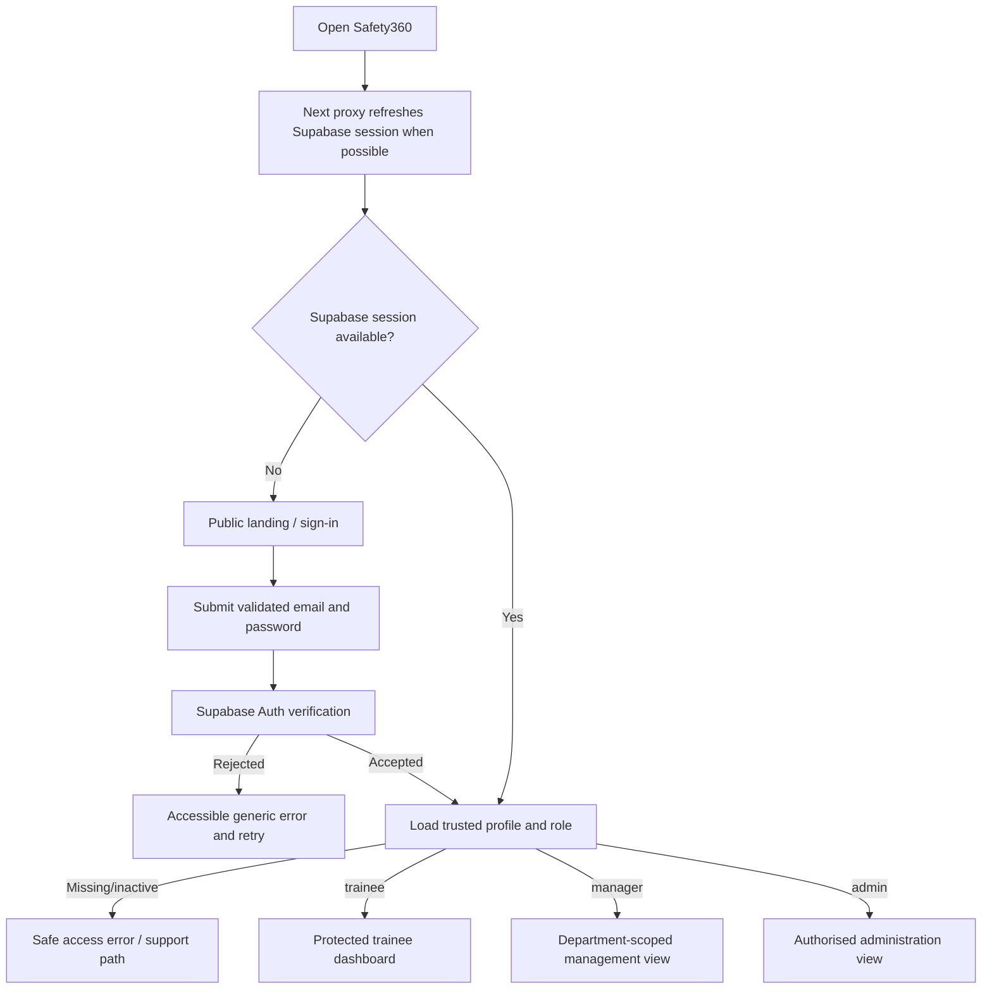
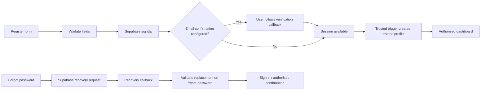
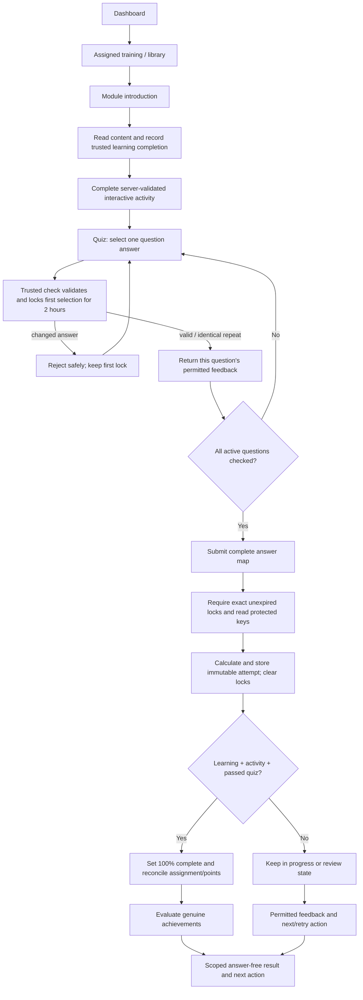
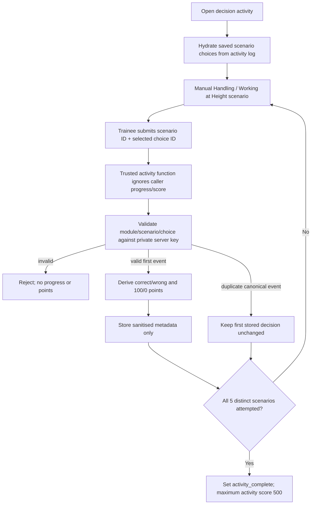
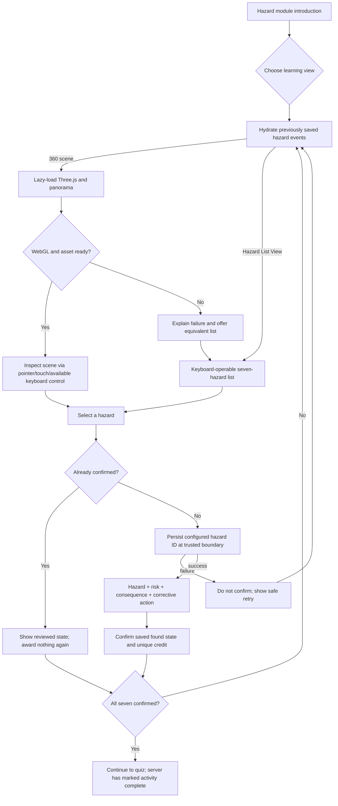
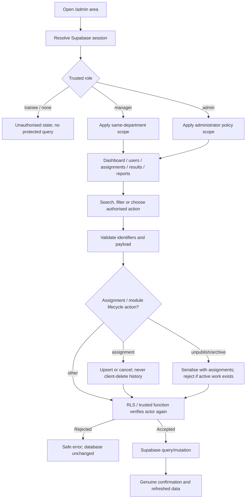
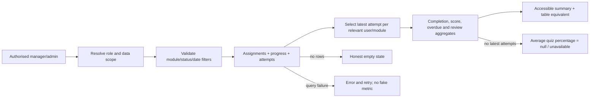

# B1 System Flows

## Authentication flow



The client never submits an authoritative role. Page-level routing provides prompt feedback, while RLS/trusted database functions remain the data boundary.

## Registration and recovery



Invalid or expired callbacks do not change a password and offer a new recovery request. The UI should not reveal whether an arbitrary email is registered.

## Training and scoring flow



If the trainee has non-cancelled assignments, overall progress is completed assigned modules divided by those assigned modules. Cancelled assignments are excluded. If none remain, published modules form both numerator eligibility and denominator. A zero denominator produces an empty state.

## Decision-activity integrity flow



Activity completion records participation in all five decisions, not a perfect score. Module completion still requires learning completion and a passed quiz. Manual Handling has a 700-point perfect combined activity/quiz total; Working at Height has 750.

## Hazard Perception flow



The two views have the same seven-hazard learning outcome. Visual hotspots are not required for completion when WebGL is inaccessible.

## Administration flow



Manager search/filter inputs cannot widen the department policy. A missing manager department must resolve to no relevant trainees, not global access.

## Reporting flow



## Sign-out and route-protection flow

```mermaid
sequenceDiagram
    participant U as User
    participant N as Next application
    participant S as Supabase Auth
    participant D as PostgreSQL/RLS
    U->>N: Choose sign out
    N->>S: Invalidate session
    alt sign-out succeeds
      S-->>N: Session removed
      N-->>U: Return to public sign-in
      U->>N: Request protected route
      N-->>U: Redirect/unauthorised without private data
    else service error
      S-->>N: Failure
      N-->>U: State that sign-out did not complete; allow retry
    end
    Note over N,D: A later database request without a valid JWT is also denied by RLS.
```

## Error and recovery rules

- Loading states describe genuine work; the 360 scene uses real readiness or an indeterminate loader, never a fake percentage.
- Authentication, validation, network, not-found and unauthorised failures have distinct messages without leaking database detail.
- A UI success state appears only after the underlying operation returns success.
- Interrupted quiz/activity writes do not claim completion; the trainee receives a safe retry action.
- Reduced-motion mode changes presentation timing only, never the state-machine outcome.
